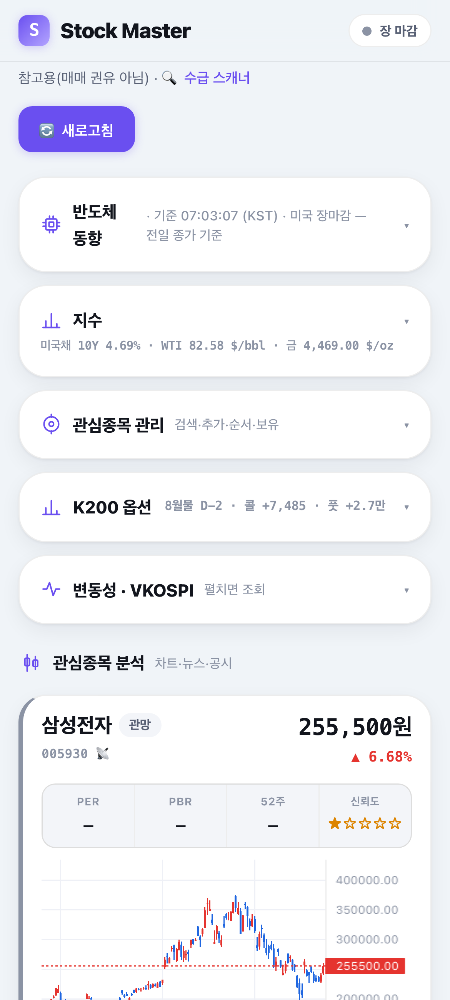
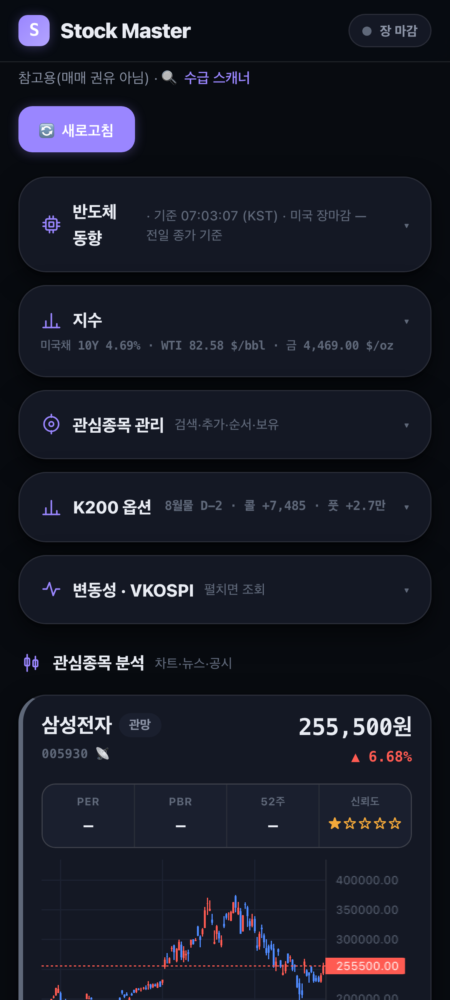
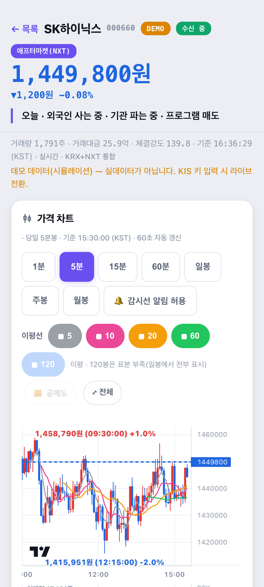

# Stock Master

한국 주식을 **장중 실시간으로 훑어, 초보자가 읽을 수 있는 말로 근거와 함께 보여주는 개인용 PWA.**
아이폰 홈 화면에 설치해서 쓴다. 매매를 대신하지 않고, 판단 재료만 한 화면에 모은다.

Python 3.9 · FastAPI · SSE · KIS 오픈API 웹소켓 · 자기완결 HTML(외부 CDN 0)
backend 13.3k LOC / tests 12.1k LOC / 테스트 750여 개

> ⚠️ 개인용·비상업 프로젝트다. 배포되지 않고, 판매되지 않으며, 광고도 없다.
> 이유는 아래 [비상업성과 한계](#비상업성과-한계).

<!-- 스크린샷은 `make verify`가 harness/artifacts/에 만든 것(390px 실렌더)의 상단을 잘라 넣었다.
     ⚠️ 새로 갈아끼울 때 반드시 지킬 것:
       - widget-*.png 는 **넣지 마라** — /widget-setup 화면에 실 위젯 토큰이 그대로 찍힌다.
       - dashboard-*.png 는 '관심종목 관리' 섹션이 접힌 상태여야 한다(펼치면 보유수량·평단이 보인다).
       - 데모 서버도 관심종목·보유는 data/(gitignore)의 실계정 파일을 읽는다. 눈으로 확인할 것. -->

| 홈 (라이트) | 홈 (다크) | 종목 상세 |
|---|---|---|
|  |  |  |

<sub>실제 렌더 결과의 상단부다(아이폰 폭 390px). 상세 화면은 세로로 30,000px가 넘어 일부만 실었다.
상세 화면의 “DEMO 데이터(시뮬레이션)” 배지는 KIS 키 없이 띄운 검증 서버라 붙은 것으로, 실사용 시엔 실시간 값이 들어간다.</sub>

---

## 왜 만들었나

한국 주식을 거의 모르는 상태로 시작했다. 문제는 정보가 없는 게 아니라 **여러 앱에 흩어져 있고,
각각이 다른 말을 쓴다**는 것이었다 — 실시간 수급은 증권사 HTS, 미국 밤 시장은 다른 앱,
공매도·대차잔고는 또 다른 곳, 그 숫자들이 무슨 뜻인지는 검색.

그래서 이 앱은 두 가지만 한다.

1. **한 화면에 모은다.** 종목 하나를 열면 가격·투자자별 수급·프로그램매매·기관 세부·거래원·대차·
   공매도·신용·거래소별 거래량·체결 규모 분포가 세로로 한 번에 나온다.
2. **번역한다.** 모든 판정은 규칙 하나 = 근거 한 줄로 만든다(LLM 없음).
   "체결강도 82.8"이 아니라 그게 무슨 뜻인지 같이 적는다.

---

## 화면

PWA 하단 탭바 3개(`홈` / `종목` / `스캐너`) + 위젯 설치·인증 화면.

### `/` — 홈 (대시보드)
- **시장 상태 펄스** — 장중/마감을 실시간 판정(`/api/market`, 30초). 공휴일은 KIS 휴장일 TR로 안다.
- **반도체 동향** — SOX·NVDA·MU·WDC·SNDK·AMAT·LRCX·KLAC·SKHY(SK하이닉스 나스닥 DR) +
  삼성전자·SK하이닉스를 한 그리드에. "간밤 SOX가 어땠나"를 국내 개장 전에.
- **지수** — 국내 지수(코스피·코스닥) · **코스피 온도**(지수 1콜로 뽑는 3지표 + 판정 단어) ·
  **지수 선물**(코스피200 주간/야간 + 나스닥) · 미국 금리(2/10/30Y) · 원자재(WTI·금) ·
  해외지수(S&P500·나스닥 종합·VIX). **칩마다 기준일과 신선도를 찍는다** — 살아 있는 코스피 칩
  옆에 놓이면 어제 값도 지금 값으로 읽히기 때문.
- **K200 옵션** — 콜/풋 보드(동적 만기 선택).
- **변동성 · VKOSPI** — 공포지수와 최근 추이.
- **관심종목 관리** — 검색(전체 KRX 유니버스)·추가·드래그 순서변경·보유수량/평단 입력·삭제.
- **관심종목 분석** — 종목별 캔들 차트 + 지표 신호 + 백테스트 게이트를 통과한 것만 "조언" +
  관련 뉴스/공시 딥링크.

### `/live/{종목코드}` — 종목 상세 (실시간)
증권사 '종목별 수급'의 축소판. **SSE로 1초마다 전체 스냅샷을 받아** 패널을 다시 그린다.

가격 차트(1/5/15/60분·일·주·월봉, 이평 5~120·감시선·공매도 겹침) · 기업 체력(밸류·수익성·부채) ·
투자자별 순매수(장중 추정) · 프로그램매매(실시간 누적) · 일별 확정 수급 ·
기관 세부 수급(연기금·투신·금융투자·사모·보험·은행·기타금융) · 거래원(회원사) 창구 분석 ·
대차잔고 · 공매도 일별 체결 · 신용융자 잔고 · **거래소별 거래량(KRX vs NXT)** ·
체결 규모 분포(주체 추정) · 실시간 체결 테이프 · ADR 환산가·괴리율(해당 종목만).

감시선(가격 알림선)은 화면에서 직접 편집하고 서버에 저장한다.

### `/live/{미국티커}` — 미국 종목 상세
일·주·월봉(각 120봉) + 감시선. **실시간은 의도적으로 없다** — KIS 웹소켓은 1키 1세션이고,
그 하나를 국내 수급과 야간선물이 이미 쓰고 있다. 빈 패널을 그냥 지우지 않고 *왜* 없는지 한 줄로 적는다.

### `/scanner` — 수급 스캐너
"오늘 뭐 볼까"를 자동 발굴. 외국인 순매수/순매도 · 기관 순매수/순매도 · 거래대금 상위 ·
급등 상위를 각 30행(+ 인기 조회 상위는 별도 엔드포인트), 그리고 **수급 ∩ 모멘텀 교차**로 뽑은
픽에 사유 칩을 붙인다. 60초 자동 갱신.

### `/widget-setup` — 홈 위젯 설치(아이폰 Scriptable · 갤럭시 앱)
Scriptable 위젯 스크립트와 계정별 읽기 토큰을 사파리에서 바로 복사. 스크립트 본문에는 토큰을
**넣지 않는다**(Scriptable이 iCloud Drive에 평문 동기화하므로 첫 실행 때 Keychain에 저장).
갤럭시는 **위젯 전용 앱**(`android/`, Kotlin + Jetpack Glance)을 이 페이지에서 APK로 내려받아 설치하고,
[앱에 자동 입력] 링크(`stockmaster://setup`)로 주소·토큰을 넣는다. 앱은 `/api/widget`만 읽는 소비자다 —
서버 힌트를 따르는 WorkManager 1회성 체인으로 장중 15분마다 1건 요청, 탭하면 즉시 갱신(iOS엔 없는 기능).
설계: `docs/superpowers/specs/2026-09-04-android-widget-design.md`.

### `/login` · `/2fa` — 인증 게이트
공개 배포 시에만 활성. Google OAuth2 → TOTP 2차 → 세션 쿠키.

---

## 아키텍처

```
아이폰 사파리 / 홈화면 PWA  ·  위젯(아이폰 Scriptable · 갤럭시 앱 android/)
      │ HTTPS (Tailscale Funnel)
      ▼
┌─ 인증 게이트 ─────────────────────────────── backend/api/auth.py
│  Google OAuth2 + TOTP + 세션 쿠키. **순수 ASGI**로 짰다 —
│  프레임워크 미들웨어로 감싸면 SSE 스트림을 버퍼링해 실시간이 죽는다.
│  크리덴셜 없이 auth_enabled=true면 기동을 거부한다(fail-closed).
└──────┬────────────────────────────────────────
       ▼
┌─ FastAPI ────────────────────────────────── backend/api/app.py
│  HTML 화면 4개(+인증 화면)  ·  JSON API 21개  ·  SSE 1개
│  화면은 backend/report/*.py가 CSS·JS·데이터를 **한 파일에 인라인**해 만든다.
│  외부 네트워크 0 — 차트 라이브러리까지 동봉(api/static/lightweight-charts.js, ~160KB).
│  CSS 단일 출처는 report/theme.py (화면들이 같은 토큰을 쓴다).
└──────┬────────────────────────────────────────
       ▼
┌─ FlowEngine ─────────────────────────────── backend/flow/engine.py
│  종목당 싱글턴. 첫 구독자에서 lazy 기동, 구독자 0이면 유예 후 정지.
│  ├─ REST 폴링: 장중 추정 수급 · 일별 확정 · 기관 세부 · 호가 · 재무
│  └─ 실시간 ──▶ wsbus (backend/flow/wsbus.py)
│                 웹소켓 **연결 1개**를 이 모듈이 단독 소유하고,
│                 소비자는 (tr_id, tr_key)로 등록만 한다.
│                 KIS 제약이 '구독 건수'가 아니라 '세션 수'이기 때문.
└──────┬────────────────────────────────────────
       ▼
┌─ KisClient ──────────────────────────────── backend/flow/kis.py
│  토큰 디스크 캐시 · HTTP 500 지수 백오프 · 호출 간 250ms · 승인키 만료 재발급
└──────┬────────────────────────────────────────
       ▼
  KIS 오픈API   FinanceDataReader   DART   RSS(한경·연합)   CNBC   미 재무부
```

배치는 웹서버 밖에 있다 — 코스피200 옵션 수집은 `launchd`가 평일 정해진 시각에
`python -m backend.cli collect-options`를 돌린다(한 회차 KIS 호출 최대 1,012건이라 실시간과
같은 키를 동시에 쓰지 않도록 분리).

---

## 데이터 출처와 제약

전부 **실측으로 확정**했다. 아래 제약은 문서가 아니라 코드 주석에 날짜와 함께 기록돼 있다.

| 원천 | 쓰는 곳 | 제약 (근거) |
|---|---|---|
| **KIS 오픈API (WebSocket)** | 실시간 체결·프로그램매매·야간선물 | **1키 1세션.** 화면마다 연결을 열면 뒤에 붙은 쪽이 `OPSP8996 ALREADY IN USE`로 영구 차단된다 — 10초 REST 폴백으로 연명해 *화면이 살아 보이는* 게 함정이었다. → `flow/wsbus.py`가 연결을 하나로 묶는다 |
| **KIS 오픈API (REST)** | 시세·수급·순위·재무·호가·선물·옵션·해외 | 개인 계정 유량 제한 + **연속 호출에 간헐 HTTP 500** → 지수 백오프 재시도 + 호출 간 250ms (`flow/kis.py`) |
| **토스증권 Open API** | 한국 국채 2~30Y 금리 · 대차거래 · 매수 유의사항(VI·투자경고) | **토큰이 client당 1개다 — 재발급하면 이전 토큰이 즉시 무효화된다**(KIS는 옛 토큰이 만료까지 살아 있었다). 검증 서버가 같은 `client_id`로 한 번 발급하면 실서버가 그 자리에서 401 → 하네스가 `SM_TOSS_*`를 비운다. **허용 IP 미등록이면 토큰 발급부터 403**(REST·웹소켓 같은 목록). 한도는 그룹별 **초당** 제한이고 문서값이 아니라 응답 헤더 `X-RateLimit-Limit`이 진실. 파생(선물·옵션)·해외지수는 **없다** |
| **FinanceDataReader** | 일봉 15년(주·월봉 원료) · WTI · 금 | 마지막 봉은 종가가 아니라 **진행 중 세션의 현재가**(10~12분 지연)인데 **날짜 라벨만 어제**다 → 신선도를 `basis`가 아니라 `basis_kind`로 판정 (`flow/worldidx.py`). 거래일인데 통째로 NaN인 행도 실제로 내보낸다 |
| **미 재무부 Atom XML** | 미국채 2/10/30Y 종가 | 영업일 ~15:47 UTC 공시(한국 아침엔 항상 직전 미국장 값). **월초엔 이번 달 엔트리가 아예 없어** 전월로 폴백 |
| **CNBC 사설 API (Tradeweb)** | 장중 미국금리 | 사설 API라 **10분 1사이클 · 한 건씩 순차** 호출로 물러선다. 대안은 전부 실측 탈락: 야후 `^TNX`는 2년물이 없고, CME 마이크로 수익률선물은 **만료된 월물을 조용히 계속** 주며, CBOT 국채선물은 가격 호가라 108.45는 금리가 아니다, MarketWatch 401, stooq 404 |
| **DART OpenAPI** | 공시 | 키 없이도 가동(빈 결과). corp 매핑 7일 디스크 캐시 |
| **RSS (한경·연합)** | 뉴스 | 한경은 feedparser 기본 UA에 **403** → 브라우저 UA 우회(회귀 테스트로 고정). 본문 미저장, 원문 딥링크만 |
| ~~KRX 정보데이터시스템~~ | — | **사용 불가.** 로그인 의무화로 `HTTP 400 LOGOUT`(pykrx 투자자 함수도 동반 사망) → KIS가 유일한 합규 경로 |
| ~~네이버 금융~~ | — | 스크래핑 금지(프로젝트 결정) |

**왜 토스로 갈아타지 않았나** (2026-09-03 스펙 전수 실사 — `openapi.json` v1.2.14 엔드포인트
33개 · `asyncapi.json` 1.2.2 채널 3개): ① 파생이 **아예 없다**(지수선물·코스피200 옵션 0개).
② 실시간 체결 프레임이 `price·volume·timestamp·currency` **4필드뿐**이라 `/live`가 쓰는
체결강도·매수/매도 구분·누적거래량을 만들 수 없다 — 스펙이 직접 "수신 프레임 합산으로 누적
거래량을 재구성할 수 없습니다"라고 못박았다. ③ `/api/v1/prices`도 4필드라 등락률·전일대비가
없다. 그래서 실시간 수급은 계속 KIS이고, 토스는 KIS에 없는 것만 REST로 가져온다.

다만 **미국 시세는 실시간이었다**(2026-09-03 실측: AAPL 체결 3회 샘플에서 조회 대비
최소 **4.2초** — 15분 지연 피드가 아니다. 데이마켓 세션 기준, 정규장은 미측정).
KIS는 해외 실시간에 거래소 신청 권한이 필요해 막혀 있던 자리다 — 미국 종목 실시간은
앞으로 열 수 있는 문이지만 아직 구현하지 않았다. 같은 날 함께 실측한 값: 호가 **10단**,
토큰 `expires_in=86399`, `X-RateLimit-Limit` 헤더가 문서 표와 일치.

**단위 함정 하나**: KIS 해외지수 TR은 주식 티커도 받는다. `CL`=93.15는 WTI가 아니라 콜게이트고
`XAU`는 금광주 지수다. 값이 0이 아니라고 그 상품이 아니다 — 그래서 `unit`을 데이터에 실어
내리고, 프런트가 단위를 추측하지 못하게 한다.

---

## 실행

```bash
python3 -m venv .venv && .venv/bin/pip install -e '.[dev]'
cp .env.example .env          # 키를 채운다(전부 선택 — 없으면 데모 모드로 뜬다)
                              # ⚠️ 이미 .env가 있으면 덮어쓰지 말 것(실사용 키가 들어 있다)

.venv/bin/python -m backend.cli serve          # 0.0.0.0:8000
# 같은 WiFi의 아이폰 사파리 → http://<맥IP>:8000 → 공유 → '홈 화면에 추가'
```

KIS 키가 없으면 자동으로 **데모 모드**(시드 랜덤워크)로 뜬다 — 화면 전부를 키 없이 볼 수 있다.
`SM_FLOW_MODE=demo`로 강제할 수도 있다.

기타 CLI:
```bash
python -m backend.cli report            # 관심종목 일일 HTML 리포트 → docs/report-daily.html
python -m backend.cli glossary          # 용어·개념 학습 페이지
python -m backend.cli shortbal --code 000660    # 대차잔고 수동 수집
python -m backend.cli collect-options   # 코스피200 옵션 보드 수집(배치)
```

Claude Desktop에서 대화로 물어볼 수 있는 MCP 서버도 있다(도구 5개:
`watchlist_summary`·`dashboard_data`·`stock_detail`·`search_stocks`·`chart_data`).
설치는 `docs/mcp-setup.md`.

### 검증

```bash
make test     # pytest 전체 + node 렌더 스모크
make eval     # 판정 문구 {text,tone} 골든 회귀 (의미 드리프트 감지)
make verify   # 6화면을 아이폰 폭(390/DSF3) 라이트·다크로 캡처 + 가로 오버플로 검출
make ops      # 로컬 8000·공개 URL·인증 게이트 읽기전용 점검
make android  # 갤럭시 위젯 APK 빌드 → data/android/StockMasterWidget.apk (8000 재기동 불필요)
```
`make verify`가 띄우는 데모 서버는 항상 `SM_FLOW_MODE=demo`·`SM_AUTH_ENABLED=false`라
**KIS를 한 번도 건드리지 않는다.** spawn한 프로세스는 PID로만 정리한다.

---

## 기술적으로 재밌었던 것

- **웹소켓 공유 세션** (`flow/wsbus.py`) — KIS 제약이 "구독 건수"가 아니라 "세션 수"라는 걸
  운영 중에 알았다. 두 종목을 열어두면 한쪽이 하루 종일 실시간을 못 받는데, REST 폴백 때문에
  화면은 멀쩡해 보였다. 연결 소유권을 모듈 하나로 옮겨 해결.
- **SSE는 델타가 아니라 전체 스냅샷** (`api/app.py`) — 1초마다 상태 전체를 보낸다.
  재연결·탭 복귀·모바일 절전 복귀 때 상태 복구가 공짜다. 대신 렌더가 매 틱 수십 개
  `textContent`를 돌므로 패널을 DOM에서 지울 수 없다(그렇게 주석에 박아뒀다).
- **자기완결 HTML** (`report/dashboard.py`) — 차트 라이브러리·데이터·렌더 JS를 한 파일에
  인라인한다. 외부 네트워크 0이라 FastAPI가 서빙하는 것과 파일로 여는 것이 완전히 같다.
- **인증 게이트를 순수 ASGI로** (`api/auth.py`) — 편한 미들웨어를 쓰면 SSE가 버퍼링돼
  실시간이 죽는다. 공개 노출 전제라 "모든 경로가 실제로 잠겼는가"를 불변식으로 두고 테스트했다.
- **개발 하네스** (`harness/`) — 임시 스크립트를 매번 짜던 걸 커밋된 커맨드 4개로 대체했다.
  특히 `verify`는 실제 헤드리스 크롬으로 아이폰 폭에서 렌더해 가로 오버플로를 잡는다.
  문자열 검사로는 안 잡히던 버그(미치환 템플릿 자리표시자, 원화 전용 반올림이 달러에 적용)가
  실렌더로만 잡혔다.
- **실측 주석 문화** — "왜 이렇게 짰나"보다 **"언제 뭘 재봤더니 뭐가 틀렸나"**를 남긴다.
  예: `SKHYV`는 KIS가 상장일 값($168.01)에 얼려둔 오종목이고 실거래 티커는 `SKHY`다
  (거래량으로 확인). 이 주석들이 같은 조사를 두 번 하지 않게 막아준다.

---

## 비상업성과 한계

**상업화는 하드블로커가 있다.** 실시간 시세의 제3자 재배포는 코스콤 법인 전용 유료 계약
사항이고, KIS 약관도 시세 제3자 제공을 금지한다. 무료 광고 모델이라도 유사투자자문 신고 여지가
남는다. 그래서 이 앱은 **1인 사용자 본인만** 쓴다 — 위젯 토큰도 "공유 금지"가 가이드 첫 줄이다.

알려진 한계:
- **전략은 out-of-sample 검증되지 않았다.** 백테스트 게이트는 *배관이 동작함*을 증명할 뿐,
  골든크로스/RSI가 실제로 수익적이라는 보장이 아니다. "검증됨" 배지를 에지로 읽으면 안 된다.
- 장중 외국인/기관은 **추정치**다(창구 기반, 하루 몇 차례 갱신, 익일 확정). 진짜 틱 실시간은
  체결가와 프로그램매매뿐 — 이건 증권사 HTS도 같다.
- 미국 종목에는 실시간이 없다(위 1키 1세션).
- 호재/악재 감성 태깅은 **의도적으로 안 한다** — 초보자 오해를 부르고 무자문 설계와 충돌한다.

> ⚠️ 투자 유의 안내 — 본 애플리케이션이 제공하는 모든 정보·분석·신호는 참고용이며, 특정 종목의
> 매수·매도를 권유하지 않습니다. 모든 투자 판단과 그 결과에 대한 책임은 이용자 본인에게 있습니다.
> 과거 성과(백테스트)는 미래 수익을 보장하지 않습니다. 데이터는 KIS·FDR·DART·언론사 등에서
> 수집되며 오류·지연이 있을 수 있습니다.

## 문서 지도

- **작업 규칙(에이전트 필독)**: `CLAUDE.md` — 실서버·KIS 1키 1세션·Python 3.9 제약.
- **정본 설계·계획**: `docs/superpowers/specs/`·`plans/`(날짜 프리픽스 = 작성 시점 기록).
- **역사 문서(현재 상태로 읽지 마라)**: `docs/design.md`(원설계) ·
  `docs/implementation-plan.md`(S0–S2, 전부 완료) · `docs/implementation-status.md`(2026-07-10) ·
  `docs/kis-unused-features.md`(대부분 이미 구현 — `kis-integration-plan.md` 참조).

## 라이선스

미지정(All rights reserved) — `LICENSE` 참조. 열람·참고는 자유롭게, 재사용·재배포는 문의 바랍니다.
실시간 시세 재배포는 별개로 KIS 약관이 금지한다.
